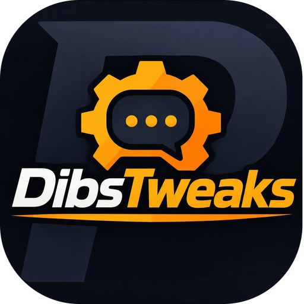

# Prat3.0-DibsTweaks

Two extra modules for the [Prat 3.0](https://www.curseforge.com/wow/addons/prat-3-0) chat
add-on, for **WoW Forever**.

## Modules

### Dibs reverse chat
Keeps chat text at the top of the window instead of the bottom.

- In a quiet chat window the first message appears on the top line and later ones go under
  it. When the oldest message has faded out, the others move up into its place.
- Once the window is full, chat scrolls as usual.
- Scrolling back stops at the oldest message instead of pushing text out of the window.
- Choose which chat windows do this ("Keep Text At The Top"). The combat log is never
  changed.

Off by default. Turn it on in Prat's options under **Module Control**.

### Dibs animated chat
Animates chat windows so they feel smoother.

- When a new message arrives, the older messages slide out of the way and the new one fades
  in. The animation is short (0.15 seconds by default).

On by default. Options: Animation Time, Slide Old Messages, Fade In New Messages.

Both modules can be used together: with both on, text kept at the top also slides into place.

## Requirements

- World of Warcraft: Forever
- [Prat 3.0](https://www.curseforge.com/wow/addons/prat-3-0)

## Settings

Open Prat's options (`/prat`). Both modules are listed under **Extras** and can be turned on
or off under **Module Control**.

## License

Copyright (C) 2026 DibsCodes. Licensed under the GNU General Public License, version 3 or
later. See [LICENSE](LICENSE).
